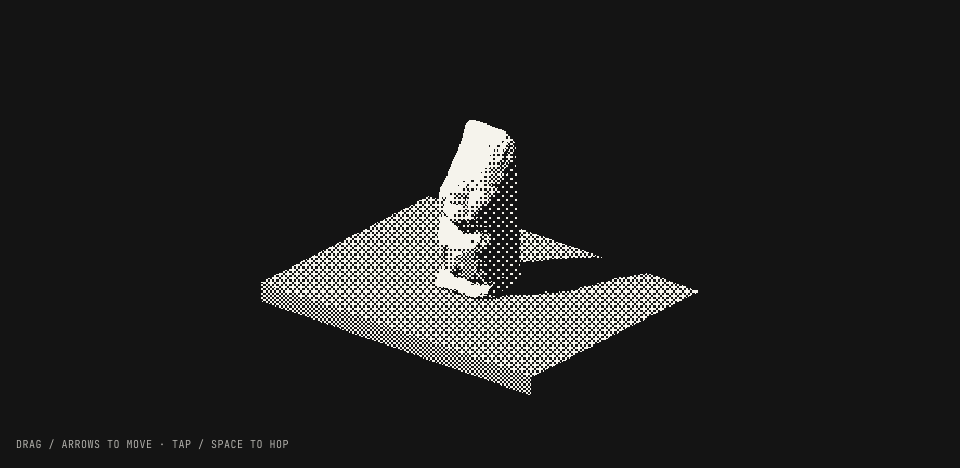
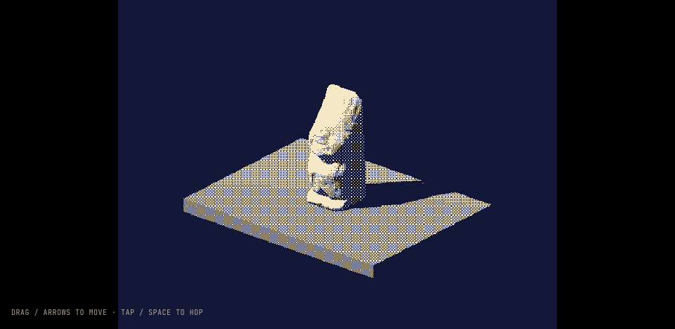
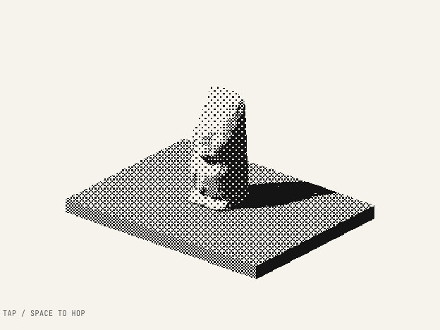
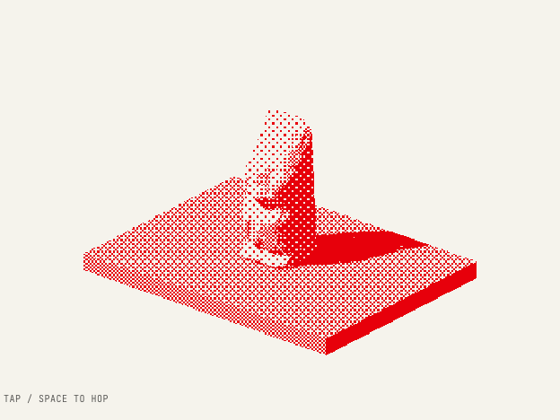

# Equilibrio: renderer study

## Try it

**Three.js is selected for the landing toy.** Godot is retained only as an animation/visual reference; the large measured gap is compressed download size, not a 32× frame-rate claim.

Run the portfolio and open **`/experimental/equilibrio`**. Default is Three.js. For a fresh Godot start without first loading Three.js, use **`/experimental/equilibrio?engine=godot`**.

Only the selected renderer runs on this study route. The original Godot repository is unchanged. The homepage `/` now runs the physical native toy described in [`equilibrio-landing.md`](equilibrio-landing.md). This isolated renderer comparison deliberately retains **flat reference physics**: its plinth rocks visually but contact stays level, so it remains comparable with the Godot slice. Both references walk, hop, raise/lower, fall off the edge and return. No score or failure screen.

Drag/arrows/WASD move; tap/Space hops; E or Raise/Lower operates the original mechanism. Tilt is opt-in, calibrated, smoothed and dead-zoned, with orientation mapping and permission/no-sensor fallbacks. Controls are scoped to the stage. Hidden tabs and the mobile menu pause simulation; reduced-motion starts paused. Renderer changes and navigation dispose the old renderer.

## Changes

| Before                                                    | After                                                                                                                                                |
| --------------------------------------------------------- | ---------------------------------------------------------------------------------------------------------------------------------------------------- |
| Only the existing shooter landing experience              | Separate comparison route retained; the homepage now uses native Equilibrio                                                                                               |
| Original character available only in the Godot repository | Original three OBJ meshes in `public/equilibrio/models/`; source coordinates/pivots retained                                                         |
| No browser-native Pícaro animation                        | `simulation.ts` translates original spring/gait equations and exact `Picaro.tscn` extension key times; fixed simulation steps keep the spring stable |
| No small web export                                       | Isolated Godot Compatibility project copies the original character scene, animator and dither shader verbatim, with a minimal toy controller         |
| Stock Godot engine exceeds Cloudflare's asset limit       | Gzip-at-rest WebAssembly with streaming decompression, checked loader integration and explicit unsupported-browser error                             |
| No appearance/performance comparison                      | Dither, ASCII and solid views; scene-ready time, live renderer counters and downloadable 15-second demo results                                      |
| No coverage for the new toy                               | Simulation/keyframe unit tests, real-browser lifecycle/renderer/benchmark/mobile tests, and route smoke coverage                                     |
| No reusable check/format commands                         | Typecheck and scoped Prettier commands; Playwright and Prettier installed as development dependencies                                                |

## Reproduce

```sh
npm run equilibrio:godot       # build the isolated export; requires original assets + Godot
npm run dev -- --port 3027 --strictPort

# In another terminal
npm run check
npm run test:equilibrio
npm run test:anim
EXPECT_BASE_URL=http://localhost:3027 npm run test:equilibrio:browser
npm run smoke -- http://localhost:3027
npm run format:equilibrio
npm run format:check:equilibrio

# Download-size/production comparison
npm run build
npm run equilibrio:sizes
npm run preview -- --port 3028 --strictPort
EXPECT_BASE_URL=http://localhost:3028 npm run test:equilibrio:browser
```

Godot defaults: `/Applications/Godot.app/Contents/MacOS/Godot`, source `/Users/teo/Proyectos/GODOT/dither`. Override `GODOT_BIN`, `EQUILIBRIO_GODOT_SOURCE`, or `GODOT_WEB_TEMPLATE` as needed. The export script fetches only the single-threaded web template from the official release archive when missing locally; it never imports or modifies the original project. See `scripts/equilibrio/godot/README.md` for the message protocol and preservation checks.

Generated exports, Playwright traces/screenshots and local Godot caches are ignored. A fresh checkout runs Three.js immediately; build the Godot export to enable the second renderer. No ESLint or GDScript linter is configured; add these if the prototype becomes permanent.

## Findings

### Download cost

Measured production assets with `npm run equilibrio:sizes`, gzip level 9 estimates (decimal MB):

| Engine-specific scene payload               |      Raw/stored | Compressed estimate |
| ------------------------------------------- | --------------: | ------------------: |
| Three.js: renderer chunks + original meshes |        ~1.10 MB |        **~0.30 MB** |
| Godot: stock engine + pack + loader/support | ~9.88 MB stored |        **~9.55 MB** |

Both exclude the shared React/portfolio UI. Three.js includes the full production Three.js chunk, not just the small custom controller. Godot's stored engine is already gzip-compressed; its original WebAssembly expands to ~38 MB. Do not mistake compressed transport for runtime memory. These are reproducible file-size measurements, not claims that every server uses the same HTTP compression.

**Recommendation: Three.js for the lightweight landing toy**, based on a roughly 32× smaller compressed renderer/asset payload and simpler integration. Godot is still the most direct animation reference and preserves the actual original scene/animator without translation.

### Appearance and animation

Both show the actual sculpt, its face and its up/down mechanism. Both retain the original foot pivot, procedural sway, breathing, jump/landing squash and spring constants. Godot uses the byte-identical animator; Three.js ports its equations and extension tracks. The native version is not claiming to load skeletal clips that do not exist.

Dither is the primary comparison: same two-color palette and Bayer 4×4 principle. Lighting/material pipelines, shadows and final compositing are not pixel-identical. ASCII is deliberately exploratory: Three.js uses a small glyph atlas, Godot uses procedural glyphs, with different cell sizes. Do **not** use their ASCII timings as a strictly matched shader benchmark. Full ASCII can still obscure the small sculpt's features; dither currently reads more clearly.

### Selected Three.js visual pass

| Before                                                                                 | After                                                                                                                                                                                                                           |
| -------------------------------------------------------------------------------------- | ------------------------------------------------------------------------------------------------------------------------------------------------------------------------------------------------------------------------------- |
| `ThreeStudy.ts`: linear Standard-material lighting produced sparse/dark ivory coverage | `rendering.ts`: scene-local material customization reproduces Godot Compatibility's separately encoded ambient/direct composition, with π-scaled light units and half-strength direct specular; original grays/normals retained |
| Full-width 576 px buffer spent resolution on empty widescreen margins                  | Centered 4:3 scene on wide screens, seamless navy margins; portrait still fills the stage and retains the 576×768 maximum scene budget                                                                                          |
| Dither measured linear RGB directly, with bottom-origin Bayer phase                    | Measure the equivalent clipped display image using Godot's 2.2 brightness curve and top-origin Bayer phase                                                                                                                      |
| Separate dither and `OutputPass` full-screen draws                                     | Fused dither/output conversion, exactly once in Dither, ASCII and Unshaded; one fewer full-screen draw                                                                                                                          |
| 512 px shadow map covered 24×24 units, with depth bias −0.002                          | Same 512 px map, tighter 20×22 coverage, bias −0.0002, normal bias 0.02; closer contact without a larger map                                                                                                                    |
| Dashboard presented engine selection as undecided                                      | Three.js development is explicit; Godot remains available as the reference                                                                                                                                                      |
| No image-readability regression guard                                                  | Image-based Godot-reference calibration, exact navy/cream palette check, and wide/portrait render-layout tests                                                                                                                  |

No bloom, AO, extra lights, new textures/dependencies, mesh changes, or animation changes were added. This is a deliberate approximation of this one ambient-plus-shadowed-key scene, not a general replacement for Godot's renderer. Materials are customized locally; no global Three shader chunks are mutated.

The native upper-sculpture region went from about **29% ivory versus Godot's 65%** to **62% versus 64%**; overall geometry coverage is about **53% versus 54%**. This is a coarse image-readability check, not exact face segmentation or pixel parity. See [`equilibrio-visual-calibration.json`](equilibrio-visual-calibration.json).

| Three.js now                                               | Godot reference                                                  |
| ---------------------------------------------------------- | ---------------------------------------------------------------- |
|  |  |

### Website palette and stronger dither

Dither is the selected visual direction. The default **Carbon** print palette uses the site's exact `--color-ink` charcoal, with a less-yellow warm paper. Red remains an optional print direction rather than tinting the default scene.

| Palette              | Inks                  | Ground                                               |
| -------------------- | --------------------- | ---------------------------------------------------- |
| **Carbon — default** | `#141414` / `#f5f3ec` | Charcoal, closest to the approved game-like look     |
| Paper                | `#141414` / `#f5f3ec` | Warm paper, like an engraving                        |
| Red print            | `#e7000b` / `#f5f3ec` | Warm paper; the site's Tailwind red-600 as print ink |

| Before                                                    | After                                                                                                                                                                            |
| --------------------------------------------------------- | -------------------------------------------------------------------------------------------------------------------------------------------------------------------------------- |
| Native navy/yellow-cream palette                          | Three curated website-matching palettes in `appearance.ts`; the Godot reference is unchanged                                                                                     |
| Fine one-source-pixel Bayer cells                         | Default 2× threshold cells, with a keyboard-accessible 1×–3× grain slider; model resolution and the 4×4 Bayer matrix are unchanged                                               |
| Light ground could swallow fully white highlights         | Paper/Red print cap material display highlights at 0.92, leaving visible ink in the head silhouette; the empty ground stays clean                                                |
| HUD/loading/pause/error colors hardcoded for navy         | Foreground and ground follow the selected palette, with dark neutral text on the light/red-print ground                                                                          |
| Style changes and resizing waited for animation to resume | A paused scene redraws once without advancing its original animation/physics                                                                                                     |
| Benchmark did not identify the visual configuration       | Palette and grain are recorded and shown per result; appearance changes cancel an in-progress measurement                                                                        |
| No palette/grain regression checks                        | Site-token, bounded grain, animation-invariance, GPU-output palette and paused-redraw tests; explicit `.ts` imports are enabled for the existing Node/Vite no-emit test workflow |

No new render passes, image textures, dependencies, larger buffers or shadow maps were added. A larger threshold cell is not a lower-resolution mesh. Uniform changes redraw the existing pipeline, rather than regenerating assets. At default 2× grain the native upper-region ivory coverage remains about **60% versus the original reference's 64%**, with 100% of the sampled geometry pixels in its intended two-color palette.

The browser tests freeze the pose before changing palette/grain, then verify actual canvas output changes while the toy remains paused. Light palette examples:

| Paper                                               | Red print                                       |
| --------------------------------------------------- | ----------------------------------------------- |
|  |  |

### Runtime measurements: limitations

The UI collects actual renderer frame intervals, mean FPS, p95 and >50 ms frame counts. Godot sends individual frame samples, not the host iframe's requestAnimationFrame rate. Draw/triangle counters include each renderer's own shadow/presentation work and are not identical geometry accounting.

Both engines were exercised in real Chromium, including Cloudflare production preview and compressed WebAssembly streaming. Saved reference-scene production diagnostics (not a physical-phone landing benchmark): [`equilibrio-browser-measurements.json`](equilibrio-browser-measurements.json); reproducible payload inventory: [`equilibrio-asset-sizes.json`](equilibrio-asset-sizes.json). All 37 simulation/loader/layout/appearance/balance/control tests, all 17 production-browser tests (9 homepage cases plus the 8 reference-study checks), the existing animation tests, typecheck, scoped formatting and route smoke checks pass. The visual calibration also passes against the dev server. Browser automation uses **SwiftShader software rendering**, with recording/instrumentation overhead. Those FPS figures are functional diagnostics, **not evidence of physical-phone GPU performance or battery usage**. Scene-ready times depend on cache and omit earlier shared-page startup. No runtime-memory or battery measurement was made.

For a selection-quality runtime comparison, close other renderers, use a production build, use the same viewport and Dither mode with 1× grain for a renderer comparison, run fresh browser contexts for cold startup and repeat each 15-second demo on the actual phone. Keep the downloaded JSON. Test iOS motion permission and sensor feel on real hardware over HTTPS; synthetic permission and orientation checks cannot establish that feel.

### Regression discovered and fixed

The adversarial browser pass identified retained movement after a visibility-only tab transition and repeated keydown reactivation after blur. A focused real-browser test first failed on both cases. The host now clears movement/pointer state when hidden or paused and ignores repeat events without a currently held key. Window blur, stage blur, visibility-only and repeat-after-blur tests all pass. The once-per-second stats must be allowed to refresh before asserting that movement stopped. A second regression caught Vite automatically HTTP-decoding gzip while Workers returned the stored archive: the loader now skips duplicate decompression when Content-Encoding already indicates gzip. Unit tests exercise both response forms, and both servers pass the Godot browser startup check.

## Next step

The engine decision, physical balance, tactile fall/return and local homepage replacement are implemented in Three.js. Keep this route as a reference rather than shipping its renderer-selection dashboard on the homepage. The outstanding release gate is the real-phone HTTPS sensor/thermal/battery pass in [`equilibrio-landing.md`](equilibrio-landing.md); no deployment has been performed.
